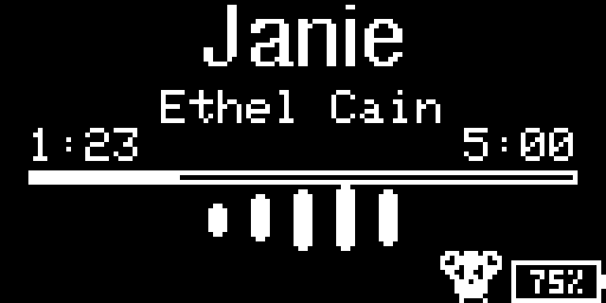

# Panda's MP3 — ESP32 SoundPod

A handmade, rechargeable MP3 player with stereo wired-headphone output, a 128×64 OLED, five buttons, and a tiny animated panda. Built by Michael Yen using an ESP32, DFPlayer Mini, and a single-cell LiPo battery.

The ESP32 handles the screen, controls and game. The DFPlayer reads the microSD card and decodes the music. Keeping these jobs separate makes the player responsive without running Wi-Fi or Bluetooth.

<p align="center">
  
  
</p>

*Images are enlarged software display previews, not photographs of a finished enclosure. The playback preview uses an example volume/battery state.*

## What it does

- Plays a numbered MP3 playlist through both ears of wired stereo headphones.
- Starts with a bobbing panda, a typewriter **“Welcome to Panda's MP3!”**, twinkling stars and an optional startup sound.
- Shows the song title, artist, elapsed time, total duration and a progress bar.
- Animates a breathing waveform while playing; temporarily replaces it with volume feedback when volume changes.
- Keeps a tiny panda wandering along the bottom, clear of the battery icon.
- Estimates battery percentage using a two-resistor voltage divider.
- Turns radios off, runs at 80 MHz and deep-sleeps after ten minutes paused. Play/Pause wakes it.
- Includes a hidden bamboo-collection game with a chasing smiley. The final score is shown at game over and resets on restart.

## Start here

| What you need | Open this |
|---|---|
| The actual program to upload | [Soundpod_ESP32.ino](firmware/Soundpod_ESP32/Soundpod_ESP32.ino) |
| Beginner assembly and programming steps | [Build guide](docs/BUILD_GUIDE.md) |
| Every pin and the power diagrams | [Complete wiring guide](docs/WIRING.md) |
| Materials and workshop tools | [Materials list](docs/MATERIALS.md) |
| Design decisions, build process and challenges | [Design report](docs/DESIGN_REPORT.md) |
| Battery percentage calibration | [Battery guide](docs/BATTERY.md) |
| Hidden game controls | [Game guide](docs/GAME.md) |
| What was checked and what remains unmeasured | [Validation](docs/VALIDATION.md) |
| Optional future song-management idea | [Parked catalog plan](docs/FUTURE_SONG_CATALOG.md) |

## Materials at a glance

| Qty | Part / ingredient | Role |
|---:|---|---|
| 1 | Classic 30-pin ESP32 dev board, USB-C / CH340 | Buttons, OLED, battery reading and game |
| 1 | Adafruit 938, 1.3-inch SSD1306 OLED, 128×64 | I²C display at `0x3D` |
| 1 | DFPlayer Mini | Reads and decodes music |
| 1 | microSD card, up to 32 GB, FAT32 | MP3 storage |
| 5 | Normally-open momentary buttons | Player and game controls |
| 1 | 3.5 mm CTIA TRRS jack/breakout | Stereo output for wired EarPods |
| 1 pair | Wired 3.5 mm EarPods / compatible headphones | Listening |
| 1 | 3.7 V, 2000 mAh single-cell LiPo | Portable power |
| 1 | Protected TP4056 board: B+/B−, OUT+/OUT− | Charging and battery protection |
| 1 | Fixed 5 V boost converter, VI/GND/VO | Raises LiPo voltage to the 5 V rail |
| 1 | Latching power switch | Disconnects power before the boost |
| 1 | 1 kΩ resistor | ESP32 TX → DFPlayer RX |
| 2 | 100 kΩ, 1% resistors | Divide battery voltage for GPIO34 |
| 1 | 100 nF ceramic capacitor | Filters the battery-sense input |
| As needed | Perfboard, hookup wire, headers and insulation | Soldered assembly |

Optional DFPlayer supply filtering uses an additional 100 nF ceramic and a 470 µF electrolytic capacitor rated at least 10 V. Optional identical 47–100 Ω resistors in the two audio channels can attenuate residual hiss and music together. These are tuning options, not a claim that every part was installed or that hiss was eliminated. See the [full materials list](docs/MATERIALS.md).

## Controls

| Button | ESP32 GPIO | Music screen | Hidden game |
|---|---:|---|---|
| Play/Pause | 33 | Pause/resume; wake from deep sleep | Restart after game over |
| Next | 19 | Next song | Move right |
| Previous | 23 | Previous song | Move left |
| Volume + | 4 | Increase volume on release | Move up |
| Volume − | 5 | Decrease volume on release | Move down |
| Both volume buttons, held 5 seconds | 4 + 5 | Enter game | Exit game, even after game over |

Release all buttons after switching modes. Game buttons do not change audio volume or track. Music keeps its previous playing/paused state, and automatic next-song playback continues underneath the game. Each round starts at 0; scores are not saved to flash.

## Power in one picture

```text
LiPo red/black → TP4056 B+/B−

TP4056 OUT+ → switch → boost VI
TP4056 OUT− ─────────→ common GND

boost VO (5 V) → removable programming link → ESP32 VIN + DFPlayer VCC
boost GND ─────────────────────────────────→ common GND
ESP32 3V3 → OLED VIN
```

**Measure the boost output before connecting the ESP32. Never put 5 V on `3V3` or a GPIO. Disconnect the boost 5 V feed before connecting ESP32 USB for programming. Charge through the TP4056 with the player switched off.** The TP4056 board used here works with a USB-A-to-C charging cable; C-to-C support depends on the charger board's USB-C configuration circuitry.

## Software and upload

Use Arduino IDE with **ESP32 Dev Module**, upload speed **115200**, and Serial Monitor **115200 baud**. The tested ESP32 Arduino core is **3.3.12**.

Install these libraries through Library Manager:

| Library | Tested version |
|---|---:|
| Adafruit GFX Library | 1.12.6 |
| Adafruit SSD1306 | 2.5.17 |
| Adafruit BusIO | 1.17.4 |
| DFRobotDFPlayerMini | 1.0.6 |

Open `firmware/Soundpod_ESP32/Soundpod_ESP32.ino`. Keep **BambooGame.h, BatteryGauge.h, ButtonInput.h and PandaWalker.h** in that same folder. Upload the complete sketch; no external USB-to-serial breakout is needed for this ESP32 board.

The final source enables battery sensing. Install the GPIO34 divider before using it, or set `BATTERY_SENSE_CONNECTED = false`. A floating input can display a misleading percentage.

For Arduino CLI users, once the board core and libraries are installed:

```sh
arduino-cli compile --fqbn esp32:esp32:esp32 firmware/Soundpod_ESP32
arduino-cli board list
arduino-cli upload --fqbn esp32:esp32:esp32 --port YOUR_PORT firmware/Soundpod_ESP32
```

## Adding music

Put normal MP3 files in the card's `/mp3` folder:

```text
/mp3/0001.mp3
/mp3/0002.mp3
...
/mp3/0010.mp3
/mp3/0011.mp3  ← optional startup jingle, reserved outside the playlist
```

The supplied sketch has ten Ethel Cain title/artist/duration entries. **Music and startup MP3 files are not included.** Supply your own files. If you do not want a startup jingle, comment out `startStartupIntroAudio();` in `setup()`.

To change the playlist, update `songTitleTable`, `songArtistTable` and `songDurations` together. Durations are seconds. `totalTracks` is calculated from the title table. Keep normal file IDs contiguous from 1, and keep the startup jingle at an unused ID; change `STARTUP_INTRO_TRACK` and rename the jingle if the playlist grows past ten songs. Do not use `0011.mp3` as both a song and the startup sound.

The current DFPlayer interface does not expose filenames, artist tags or song duration to the ESP32. The elapsed timer is an estimate maintained by the ESP32; song completion comes from the DFPlayer. The [future catalog tool](docs/FUTURE_SONG_CATALOG.md) is parked and is not integrated into the player.

## Repository map

```text
firmware/
  Soundpod_ESP32/       Final .ino and its four required headers
  01_Board_Test/       Bare-board diagnostic sketch
  02_OLED_Test/        Display diagnostic sketch
  03_Audio_Test/       DFPlayer diagnostic sketch
  04_Button_Test/      Button diagnostic sketch
  tests/               Host-side regression checks
assets/                Selected display previews
docs/                 Wiring, assembly, design report and troubleshooting
extras/song_catalog/   Inactive offline catalog helper
tools/                Check runner and repository validation
```

This release keeps the final ESP32 implementation and relevant references. Older controller versions, cancelled designs, local conversation exports, music files and generated build binaries are not part of the published package.

## Build challenges

| Obstacle | What helped |
|---|---|
| ESP32 too wide for one breadboard | Used two breadboards with every pin row accessible |
| DFPlayer error after soldering | Found roughly 1.8 kΩ between supposed grounds; repaired the joint to restore a direct ground connection |
| Next button missed short taps | Sampled/debounced buttons independently and queued events during display/audio work |
| Songs skipped twice automatically | Processed completion messages as a batch and rejected early duplicates after a new selection |
| First song silent on startup | Initialized the DFPlayer earlier, allowed settling, and checked/retried initial playback |
| DFPlayer error after waking | Selected SD mode, waited for a real response, and added a bounded reset fallback |
| Battery percentage jumped | Added averaging/filtering and documented voltage sag, recovery and calibration limits |
| Steady headphone hiss | Checked DAC/jack wiring, supply filtering and routing; retained attenuation options without claiming a complete cure |

The [design report](docs/DESIGN_REPORT.md) explains the process and remaining limitations. [Validation](docs/VALIDATION.md) separates compiled/simulated results from physical measurements. Battery runtime and full-system sleep current have not been measured.

## Dependencies and use

Third-party libraries are installed separately and retain their own licenses. Existing notices in the program are preserved; this repository does not relicense external code or bundled fonts. See [dependencies](docs/DEPENDENCIES.md).
