# Build photos and videos

Photos and recordings of Panda's ESP32 MP3 player, from the breadboard prototype to the soldered assembly.

[Back to the project README](../../README.md)

## Photos

### Finished assembly — front and controls

[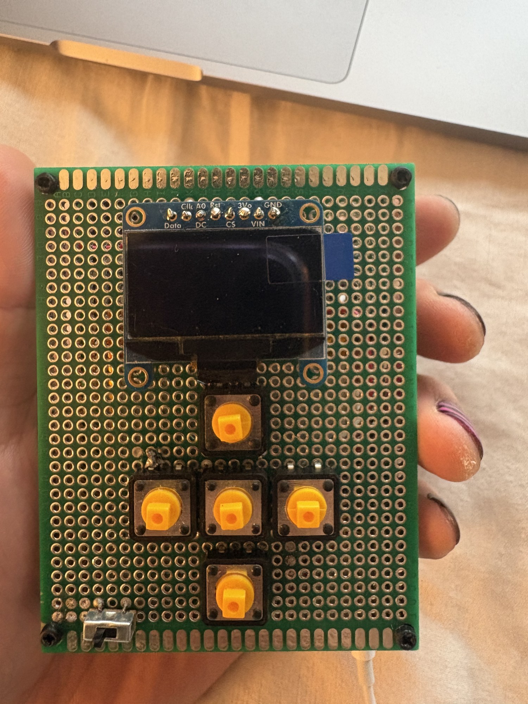](IMG_7909.jpg)

### Side view — internal wiring and stacked boards

[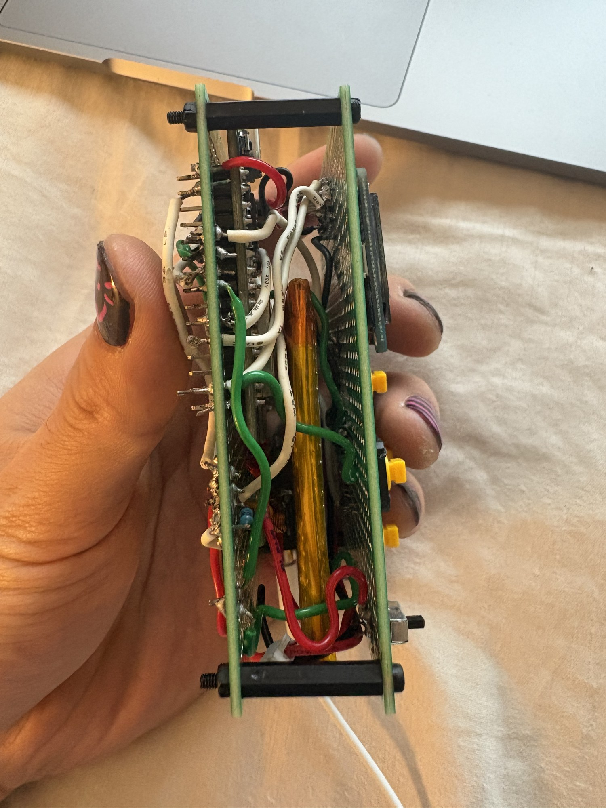](IMG_7910.jpg)

### Rear view — soldered connections

[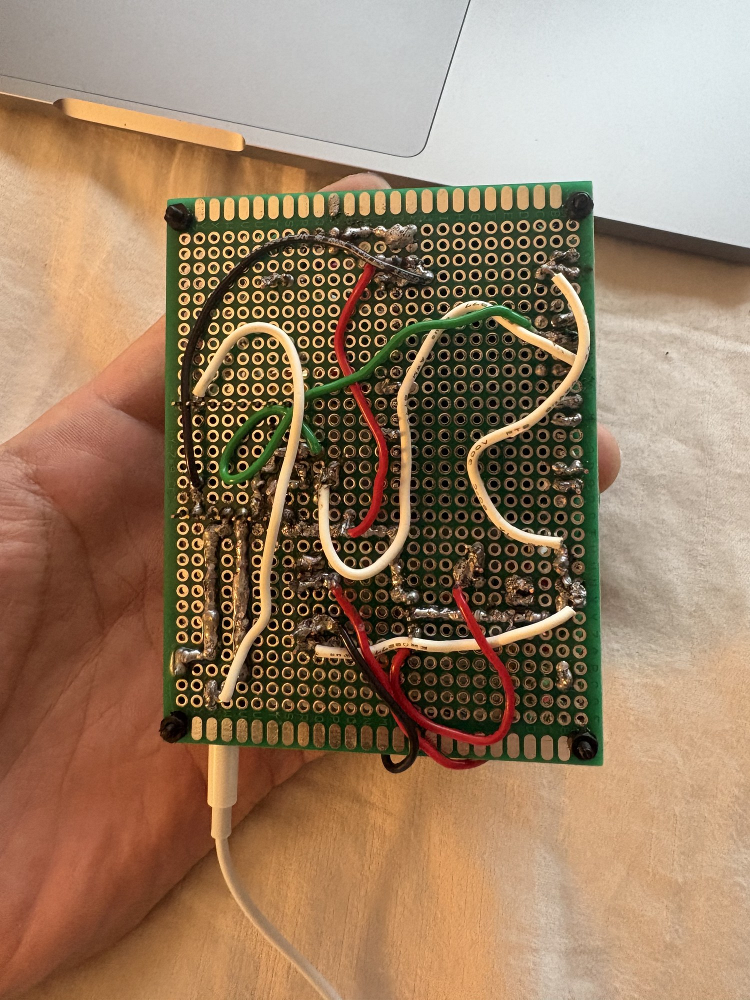](IMG_7911.jpg)

### Side view — battery and board spacing

[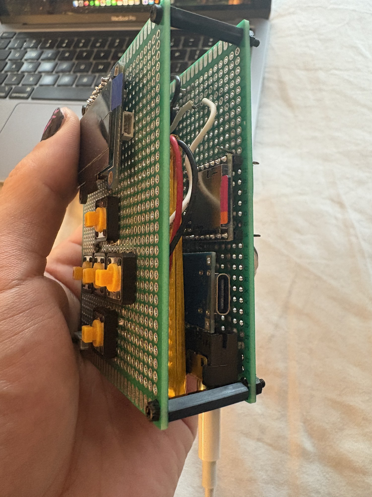](IMG_7912.jpg)

### Internal layout from the opposite side

[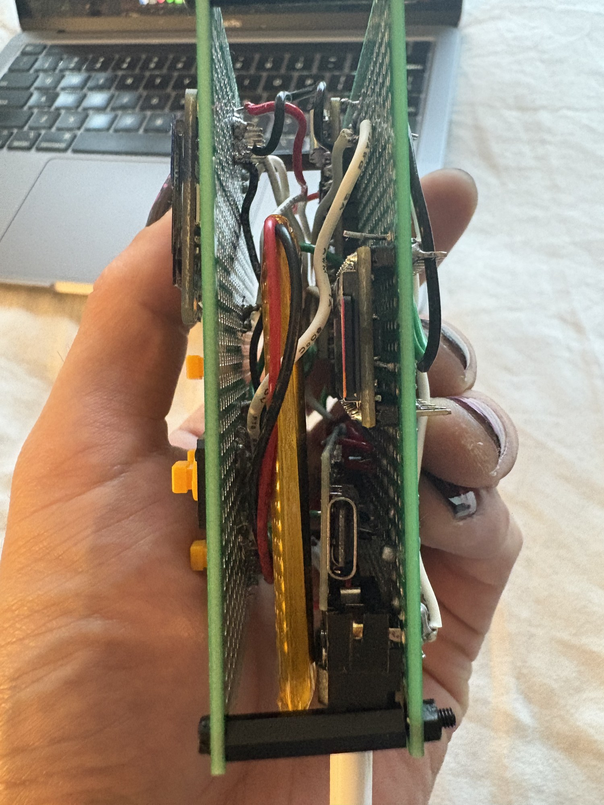](IMG_7913.jpg)

### Breadboard prototype with battery and OLED

[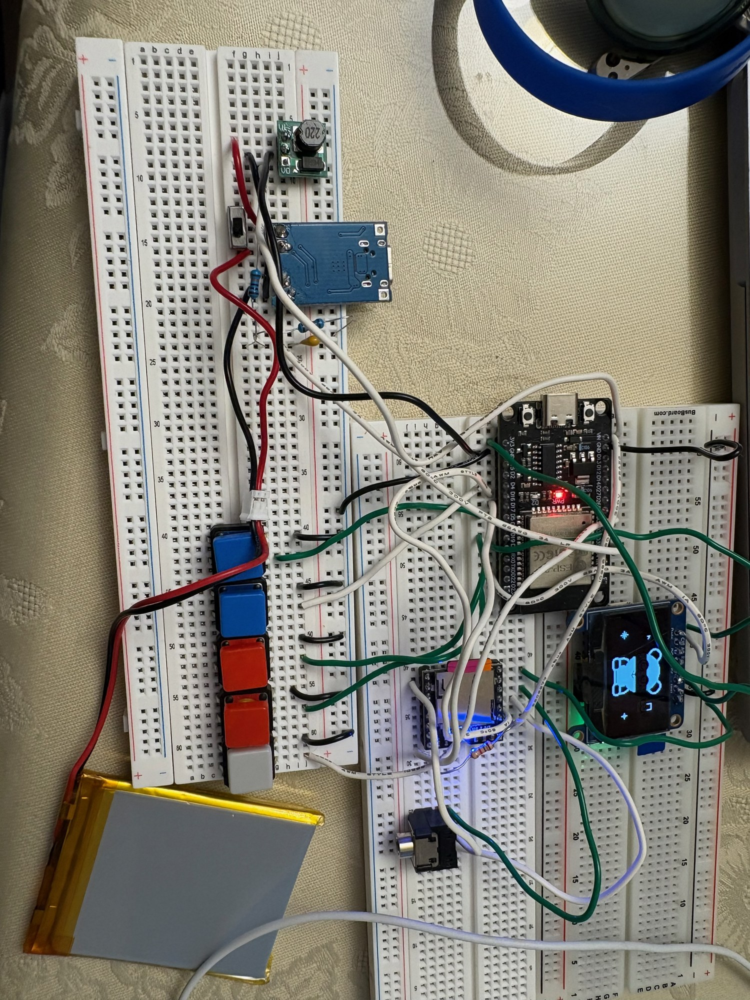](IMG_6540.jpg)

### Hand-drawn wiring sketch

[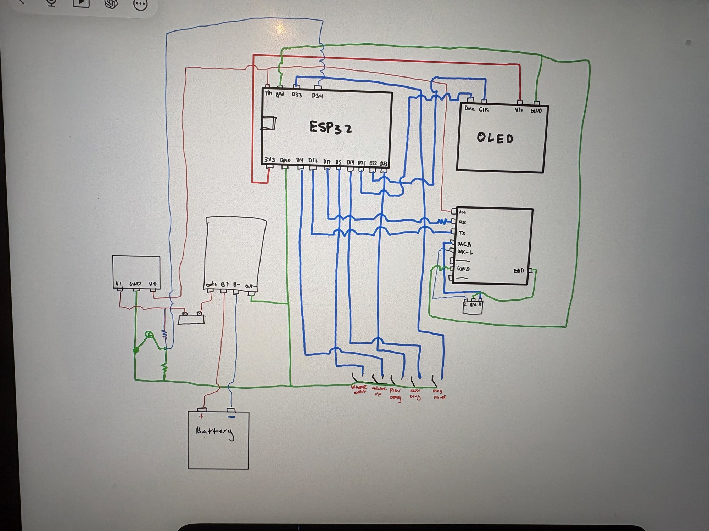](IMG_7032.jpg)

The hand-drawn sketch records the build process. For the final pin assignments, power connections and jack contacts, use the [wiring guide](../../docs/WIRING.md).

## Video demos

Click a thumbnail or its MP4 link to open/download the full clip. The copies include the original stereo recording; no clip was intentionally trimmed.

### Soldered player demonstration

[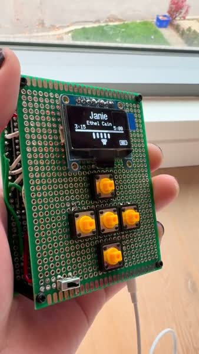](IMG_7914.mp4)

[Open/download IMG_7914.mp4](IMG_7914.mp4) · 0:26 · 10.58 MiB

### Breadboard build and power-stage recording

[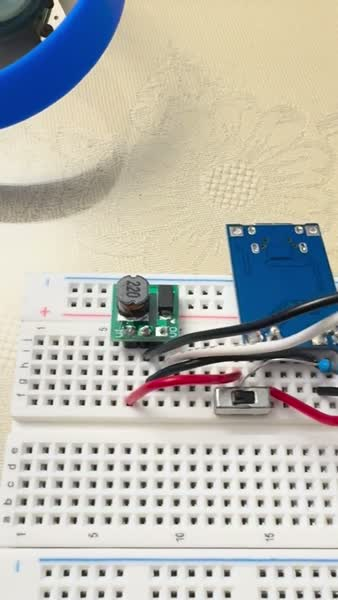](IMG_6539.mp4)

[Open/download IMG_6539.mp4](IMG_6539.mp4) · 0:30 · 8.05 MiB

### Breadboard player demonstration

[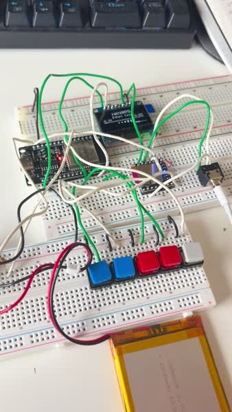](IMG_6520.mp4)

[Open/download IMG_6520.mp4](IMG_6520.mp4) · 1:08 · 13.39 MiB

### Early prototype recording — clip 2

[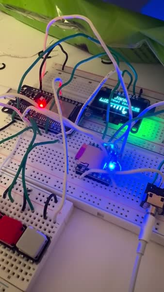](IMG_6486.mp4)

[Open/download IMG_6486.mp4](IMG_6486.mp4) · 0:05 · 0.62 MiB

### Early prototype recording — clip 1

[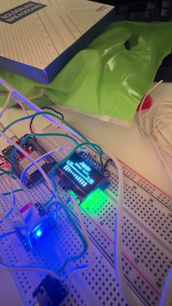](IMG_6482.mp4)

[Open/download IMG_6482.mp4](IMG_6482.mp4) · 0:06 · 0.53 MiB

## File formats

The five HEIC photos were converted to JPEG, and the two supplied JPEGs were resized alongside them (longest edge up to 2000 pixels). The five MOV recordings were converted to full-length H.264/AAC MP4 copies, up to 1280 pixels on the longest edge. HDR recordings were converted to SDR for broader compatibility. Source filenames are preserved in recognizable form; the original Downloads files were not modified.

The repository contains the web copies, not duplicate camera originals. [manifest.json](manifest.json) maps each of the 12 supplied originals to its published copy and records sizes, durations and checksums.
