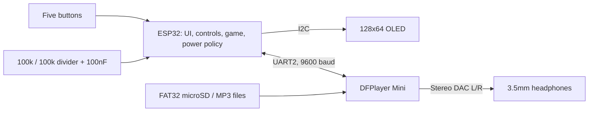

# Design report — Panda's ESP32 SoundPod

## Project aim

Build a compact, rechargeable music player with tactile controls, wired stereo headphones and a friendly panda interface. The project combines electronics assembly, power conversion, audio control, embedded programming and a small interactive game. The builder considers the project complete; this repository records the final source and construction method rather than every exploratory revision.

## Design protocol

| Stage | Method | Checkpoint / reason |
|---|---|---|
| Define the experience | Pick headphone playback, five controls, readable song information and a panda theme | Keep the interface usable on a small monochrome screen |
| Partition the system | Let the ESP32 handle logic and the DFPlayer decode audio | Avoid decoding audio in the UI controller |
| Prototype | Wire on two breadboards and test board, OLED, audio and controls separately | Isolate faults before combining subsystems |
| Establish electrical nets | Separate protected raw battery, 5 V, 3.3 V, common ground and battery sensing | Avoid connecting incompatible voltage levels |
| Implement the player | Add metadata, progress, pause accounting and event-based next-track playback | Keep visible time and actual track completion separate |
| Review the display | Render frames at 128×64 and enlarge without smoothing | Check title sizes, icon spacing and the tiny panda's reserved area |
| Improve robustness | Queue debounced inputs, guard duplicate completion events and handle audio startup/wake separately | Protect against short taps and module timing differences |
| Add power management | Disable unused radios, reduce CPU speed and sleep after paused inactivity | Reduce consumption while preserving music playback |
| Add the game | Review still frames before implementing a separate game/input layer | Keep game controls from changing music state |
| Solder and troubleshoot | Transfer connections to perfboard, inspect joints and measure voltages/resistance | A working breadboard does not guarantee correct soldered continuity |
| Package the result | Keep the final sketch, headers, useful diagrams, diagnostic sketches and checks | Make the build understandable and reproducible |

## System design

The five-button sampler runs separately from OLED transfers and audio commands. A queue preserves discrete presses. Held-state routing handles four-direction game movement and the five-second volume-button chord. All DFPlayer and display operations stay in the main loop.

The firmware keeps its title/artist/duration tables on the ESP32. It cannot inspect the DFPlayer's card directly. `playMp3Folder()` selects numbered files, and DFPlayer completion events trigger the next song. A software elapsed timer subtracts pauses; it is not a sample-accurate position reported by the audio module.

The battery gauge measures voltage through a divider, averages samples, applies filtering and converts voltage to an approximate percentage. It is not a coulomb-counting fuel gauge and does not report charging status.

## Important choices

| Decision | Reason | Trade-off |
|---|---|---|
| Classic ESP32 with onboard USB programming | Reused an available working board after a controller problem | Development-board regulator, serial chip and LEDs still draw power |
| I²C OLED with original jumpers | Matches the existing display configuration | Address and controller must match the actual module |
| DFPlayer stereo DAC outputs | Suitable signal path for wired stereo headphones | Module hiss and clone behaviour can vary |
| Protected LiPo → TP4056 → boost → 5 V | Battery voltage changes during discharge; board VIN needs a suitable regulated supply | Adds conversion loss and requires USB power isolation |
| Separate GPIO34 ADC divider | Battery can reach 4.2 V, above the ESP32 input supply | Percentage depends on calibration and cell behaviour |
| 80 MHz and unused radios off | DFPlayer handles audio decoding | Real system power still needs measurement |
| Deep sleep after ten minutes paused | Saves energy if left idle | Wake restarts the retained song; exact paused audio position is not restored |
| Score per game round | Show a meaningful final result and fresh restart | No lifetime score or flash persistence |
| Thin pulsing bamboo and smiley pursuer | Remain recognizable at small pixel dimensions | Tiny display limits detailed artwork and collision feedback |

## Obstacles and how they were addressed

| Challenge | Symptom / evidence | Response | Outcome / remaining limit |
|---|---|---|---|
| Controller substitution | Earlier controller was not working | Use the available ESP32 and its USB programming interface | Final build targets ESP32 Dev Module |
| Breadboard width | ESP32 occupied too much of a single board | Bridge two breadboards | Both pin rows accessible |
| OLED configuration | Existing OLED required matching I²C mode/address | Keep jumpers unchanged; use SDA21/SCL22 and 0x3D | Firmware matches the known Adafruit display |
| First song silent | UI appeared to play; skipping forward/back restored the first song | Initialize before intro, allow settling, explicitly select SD/DAC/volume and check startup state | Startup path includes bounded retries; not an infinite reset loop |
| Wake error | DFPlayer error shortly after deep-sleep wake | Recover the still-powered module, validate an SD response, then try one reset fallback | Separates wake behaviour from cold boot |
| Double auto-next | Song completion skipped an extra song | Batch incoming events and reject early duplicates after each selection | Host regression checks cover duplicates, wrapping and manual-next races |
| Unresponsive buttons | Short presses were sometimes lost | 5 ms sampler, 30 ms debounce, ordered event queue; remove runtime ACK waits | Tests preserve taps across simulated blocked UI work; physical switches still need sound joints |
| DFPlayer ground after soldering | Around 1.8 kΩ between ESP32 GND and DFPlayer GND | Repair the direct common-ground connection and retest continuity | Builder reported playback restored; good grounds should be near probe-lead resistance |
| Battery path not powering player | Protected output had voltage while boost input/output did not | Trace OUT+ → switch → VI and OUT− → GND, checking solder joints | Diagnostic method documented; no final measured rail values are invented here |
| Contact-dependent startup | Touching OUT− with a probe made it start | Suspect a loose joint; repair and verify stable continuity | A DC voltmeter should not be a required part of the power connection |
| Headphone hiss | Steady hiss while playing, absent when paused | Verify DAC contacts, UART resistor, clean supply, short wires and optional filtering/attenuation | No measured complete hiss elimination was recorded |
| Battery % rises/falls | Readings such as 85% then 92% | Explain load sag/recovery, smooth samples and calibrate against the meter | Still an approximate voltage-based indicator |
| USB-C charging incompatibility | USB-A-to-C worked while C-to-C did not | Use the working cable; explain missing/miswired CC pull-downs as a likely board limitation | Exact charger-board CC circuit was not measured |
| Game controls conflicted with music | Same buttons serve two purposes | Route input by mode, consume entry/exit chord and require release | Tests cover cancellation, continued holds and first fresh tap after exit |

## Later comfort and display fixes

| Issue | Change | Limit |
|---|---|---|
| Level 2 felt medium-loud and 30 was excessive | Start at 1, use single-step changes, cap at 20 | Level 1 is the lowest nonzero DFPlayer setting; quieter output may require physical attenuation |
| OLED occasionally appeared upside down | Reassert normal segment/COM mapping before every frame and periodically while idle | No intentional rotation path was found; the underlying supply or I²C fault is not established |

## What worked and what is still limited

The player evolved through separate board, audio, display and button tests into a soldered assembly. The final firmware contains the complete UI, power policy and game. The newest game/score revisions are compile- and host-tested; a compile log is not a claim of physical upload or gameplay validation.

Runtime, whole-device sleep current, battery capacity and final audio noise were not measured. The basic TP4056 arrangement does not support proper simultaneous playback/charging. Deep sleep leaves the boost and other powered components connected. GPIO34 percentage is approximate, and music duration remains manually entered in this release.

## Future work kept separate

The optional catalog helper can parse filenames, sort songs and measure durations on a computer. USB synchronization and ESP32 catalog storage are not implemented. Its documentation lives in [FUTURE_SONG_CATALOG.md](FUTURE_SONG_CATALOG.md), explicitly outside the finished firmware feature set.
