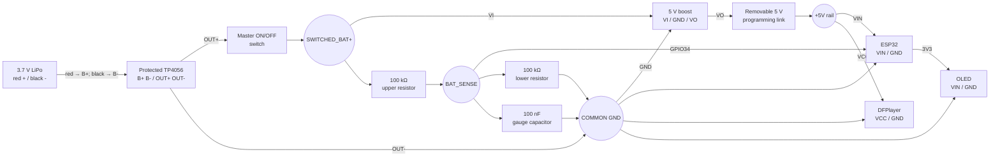

# Panda MP3 player — complete PCB wiring guide

This guide is the electrical source of truth for transferring the working breadboard player to solderable perfboard/protoboard. It matches the active ESP32 firmware.

## Before soldering

- Build with the LiPo, TP4056 charger and ESP32 USB cables disconnected.
- Use sockets or female headers for the ESP32, DFPlayer and OLED when possible.
- Leave the ESP32 antenna end at the PCB edge with no copper, ground plane, battery or module directly underneath it.
- Put the boost converter and TP4056 away from DAC_L, DAC_R and the headphone jack.
- Keep battery, 5 V and ground wiring short and thicker than signal wiring.
- Keep the TP4056 USB-C socket, ESP32 USB-C socket, microSD slot, headphone jack, power switch and status LEDs accessible.

## Named electrical nets

| Net | Meaning |
|---|---|
| `BAT+` / `BAT-` | LiPo terminals connected only to TP4056 B+ and B- |
| `RAW_PROTECTED+` | TP4056 OUT+ before the power switch |
| `SWITCHED_BAT+` | Raw LiPo voltage after the switch and before the boost converter |
| `GND` | TP4056 OUT-, boost GND and every circuit ground |
| `+5V` | Regulated boost output after the removable programming link |
| `+3V3` | ESP32 3V3 output for the OLED only |
| `BAT_SENSE` | Midpoint of the battery divider connected to GPIO34 |

## Complete power and battery-gauge diagram



The removable `+5V` programming link prevents the computer's USB supply from feeding backward into the boost converter. Remove it before connecting ESP32 USB. Install it for battery operation. The existing master switch remains before boost `VI`, so the boost does not drain the battery while switched off.

## ESP32 connection list

Use the labels printed on Michael's 30-pin ESP32 board.

| ESP32 pin | Connect to | Purpose |
|---|---|---|
| `VIN` | `+5V` rail after programming link | Battery-powered ESP32 input |
| `GND` | Common `GND` | Logic/power reference |
| `3V3` | OLED `VIN` | OLED power only |
| `D21` | OLED `Data/SDA` | I2C data |
| `D22` | OLED `Clk/SCL` | I2C clock |
| `D16` | DFPlayer `TX` | ESP32 UART receive |
| `D17` | 1 kΩ resistor, then DFPlayer `RX` | ESP32 UART transmit |
| `D33` | Play/Pause/Wake button | Other button terminal goes to GND |
| `D19` | Next button | Other button terminal goes to GND |
| `D23` | Previous button | Other button terminal goes to GND |
| `D4` | Volume Up button | Other button terminal goes to GND |
| `D5` | Volume Down button | Other button terminal goes to GND; keep released during reset |
| `D34` | `BAT_SENSE` | Battery ADC input only |

All other ESP32 pins stay unconnected. Do not connect boosted 5 V to `3V3`.

## ESP32 physical-side reminder

With the ESP32 USB-C socket at the top:

```text
LEFT PIN ROW                         RIGHT PIN ROW

3V3  ───────────── OLED VIN          VIN  ───────────── +5V rail
GND  ───────────── common GND        GND  ───────────── common GND
D15  ───────────── unused            D13  ───────────── unused
D2   ───────────── unused            D12  ───────────── unused
D4   ───────────── Volume Up         D14  ───────────── unused
D16  <──────────── DFPlayer TX       D27  ───────────── unused
D17  ── 1 kΩ ────> DFPlayer RX      D26  ───────────── unused
D5   ───────────── Volume Down       D25  ───────────── unused
D18  ───────────── unused            D33  ───────────── Play/Pause/Wake
D19  ───────────── Next              D32  ───────────── unused
D21  ───────────── OLED SDA          D35  ───────────── unused
RX0  ───────────── unused            D34  <──────────── BAT_SENSE
TX0  ───────────── unused            VN   ───────────── unused
D22  ───────────── OLED SCL          VP   ───────────── unused
D23  ───────────── Previous          EN   ───────────── leave accessible
```

## DFPlayer and headphone jack

| DFPlayer pin | Connect to |
|---|---|
| `VCC` | `+5V` rail |
| Either `GND` | Common GND |
| `TX` | ESP32 D16 |
| `RX` | ESP32 D17 through 1 kΩ |
| `DAC_L` | Left-channel series-resistor footprint, then jack tip |
| `DAC_R` | Right-channel series-resistor footprint, then jack ring 1 |
| `SPK1`, `SPK2` | Unconnected |

For the Apple EarPods CTIA plug:

```text
DFPlayer DAC_L ── R_L ── jack TIP       (left ear)
DFPlayer DAC_R ── R_R ── jack RING 1    (right ear)
DFPlayer GND   ───────── jack RING 2    (headphone ground)
                              SLEEVE    (microphone; leave unconnected)
```

Fit wire links in `R_L` and `R_R` initially. If steady hiss remains after power filtering, replace both links with identical 100 Ω resistors; try 47 Ω if 100 Ω is too quiet. Never use 100 kΩ here and never put a resistor in headphone ground.

## DFPlayer power filtering

Place both capacitors next to DFPlayer VCC/GND:

```text
+5V ──┬──────── DFPlayer VCC
      ├── 100 nF ceramic ──┐
      └── 470 µF (+)       │
GND ────── 470 µF (-) ─────┴── DFPlayer GND
```

The 100 nF ceramic capacitor has no polarity. The electrolytic capacitor's striped negative leg goes to GND. This is a separate 100 nF capacitor from the battery-gauge capacitor.

## Buttons

Each button is normally open:

```text
GPIO ───── button ───── GND
```

| Button | GPIO |
|---|---:|
| Play/Pause/Wake | D33 |
| Next | D19 |
| Previous | D23 |
| Volume Up | D4 |
| Volume Down | D5 |

For four-leg tactile switches, identify the two internally connected pairs with continuity mode. Connect the GPIO and GND to different pairs so pressing the switch joins them. Do not rely on the switch's orientation or appearance.

## Recommended board placement

This is a functional zone layout, not a hole-by-hole drawing:

```text
┌─────────────────────────────────────────────────────────────┐
│ TP4056 USB-C   POWER SWITCH    BOOST      5V LINK           │
│ [charger]──────[ ON/OFF ]─────[5 V]──────[remove for USB]   │
│      │                           │                           │
│   LiPo connector          thick +5V/GND buses               │
│                                                             │
│ OLED connector         ESP32 socket/header                  │
│ SDA/SCL/3V3/GND        USB accessible       ANTENNA → edge  │
│                         no copper/modules below antenna      │
│                                                             │
│ Battery divider              DFPlayer + filter capacitors   │
│ near GPIO34                  short DAC wires ── headphone jack│
│                                                             │
│ [Play] [Next] [Previous] [Vol +] [Vol -]                    │
└─────────────────────────────────────────────────────────────┘
```

Keep the boost converter in the power corner and the DFPlayer/headphone jack in the opposite audio corner.

## Soldering order

1. Mark the top and bottom of the PCB and photograph the blank board.
2. Install module sockets/headers, connectors, switch and buttons without power.
3. Install the common GND bus and verify continuity from every intended ground point.
4. Install BAT+/BAT-, TP4056, switch, boost input, removable 5 V link and +5 V rail.
5. Leave ESP32, DFPlayer and OLED removed. Connect the battery and verify: battery voltage, switched voltage and boost VO near 5.0 V. Check the sense node after installing the divider in the next step.
6. Disconnect all power. Install the 100 kΩ divider, gauge capacitor and GPIO34 sense wire.
7. Install ESP32 and OLED; power briefly and verify startup/display.
8. Disconnect power. Install DFPlayer UART, VCC/GND, filter capacitors and microSD.
9. Install DAC/jack wiring and verify left/right/ground contacts.
10. Install buttons and continuity-test each: open when released, near zero ohms to GND when pressed.
11. Inspect both PCB sides under bright light for solder bridges and loose strands.
12. Perform the staged first-power checks below before listening through EarPods.

## Multimeter checks before first full power

With all power disconnected:

- Confirm LiPo red reaches only TP4056 B+ and black reaches B-.
- Confirm no direct continuity between +5V and GND. Capacitors can cause a momentary changing reading; a steady near-zero reading indicates a short.
- Confirm each 100 kΩ divider resistor measures about 100 kΩ.
- Confirm D17 reaches DFPlayer RX only through the 1 kΩ resistor.
- Confirm headphone ground reaches DFPlayer GND and does not connect to the microphone sleeve.

Power-stage test, with modules initially removed:

| Measurement | Expected |
|---|---:|
| TP4056 B+ to B- | About 3.0–4.2 V |
| TP4056 OUT+ to OUT- | Approximately battery voltage |
| Switch OFF: boost VI to GND | About 0 V |
| Switch ON: boost VI to GND | Approximately battery voltage |
| Boost VO to GND | About 4.8–5.2 V |
| BAT_SENSE to GND | Approximately half battery voltage |

After installing all modules, run from battery with ESP32 USB unplugged and confirm ESP32 VIN remains close to 5 V while music plays.

## Programming, battery use and charging

### Programming

1. Master switch OFF.
2. Remove the `+5V` programming link between boost VO and the player 5 V rail.
3. Connect ESP32 USB-C and upload.
4. Disconnect ESP32 USB-C when finished.

### Battery use

1. ESP32 USB-C disconnected.
2. Install the `+5V` programming link.
3. Turn the master switch ON.

### Charging

1. Master switch OFF.
2. ESP32 USB-C disconnected.
3. Connect a 5 V USB-A-to-USB-C charger to the TP4056.
4. Use the TP4056 LEDs for charging/full status.
5. Unplug the charger before turning the player ON.

The basic TP4056 circuit has no load-sharing controller, so do not play while charging.
